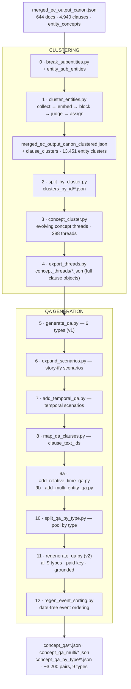

# EC Extraction → Q&A Pipeline (Gemini V3)

End‑to‑end documentation of the **clustering‑to‑QA** pipeline in
`cluster/EC Extraction Gemini V3/`. It takes the raw Entity‑Concept (EC)
extraction of a corpus of Bangladeshi customs/tax legal documents and turns it
into a grounded, multi‑type **question‑and‑answer dataset** about how each policy
concept *evolves over time*.

The core idea: **embeddings only propose candidates; Gemini is the judge.** The
pipeline first decides which entity mentions are the *same referent*, groups the
clauses that touch each referent, uses Gemini to trace how that concept *changed
across dates* into "evolving threads", and finally generates Q&A grounded in each
thread — with every pair cited back to the exact source clause(s).

---

## 1. Pipeline at a glance



| # | Script | In → Out | What it does |
|---|--------|----------|--------------|
| 0 | [break_subentities.py](../break_subentities.py) | `..._canon.json` → `..._subentities.json` | Break each high‑level entity into concrete **sub‑entities** grounded in its concept text |
| 1 | [cluster_entities.py](../cluster_entities.py) | `..._subentities.json` → `..._clustered.json` | Cluster entities by referent (embed → candidate blocks → Gemini judge), tag each clause with its **`clause_clusters`** |
| 2 | [split_by_cluster.py](../split_by_cluster.py) | `..._clustered.json` → `clusters_by_id/` | One JSON file per entity cluster, holding every clause in it |
| 3 | [concept_cluster.py](../concept_cluster.py) | `clusters_by_id/` → `concept_results.json` | Per cluster, Gemini finds the **evolving concept thread(s)** (what changed across dates) |
| 4 | [export_threads.py](../export_threads.py) | `concept_results.json` → `concept_threads/` | Materialise each thread with **full clause objects** embedded |
| 5 | [generate_qa.py](../generate_qa.py) | `concept_threads/` → `concept_qa/` | Generate the first **6 Q&A types** per thread |
| 6 | [expand_scenarios.py](../expand_scenarios.py) | `concept_qa/` (in place) | Rewrite `scenario` fields into vivid stories |
| 7 | [add_temporal_qa.py](../add_temporal_qa.py) | `concept_qa/` (append) | Add **temporal_scenario_short_answer** type |
| 8 | [map_qa_clauses.py](../map_qa_clauses.py) | `concept_qa/` (in place) | Deterministically attach **`clause_text_ids`** to every pair |
| 9 | [add_relative_time_qa.py](../add_relative_time_qa.py) · [add_multi_entity_qa.py](../add_multi_entity_qa.py) | `concept_qa/`, `concept_qa_multi/` | Add **relative_time_qa** and cross‑concept **multi_entity_concept_qa** |
| 10 | [split_qa_by_type.py](../split_qa_by_type.py) | → `concept_qa_by_type/` | Pool all pairs into one file per type (with provenance) |
| 11 | [regenerate_qa.py](../regenerate_qa.py) | → `concept_qa/`, `concept_qa_multi/` | **v2 rebuild** of all 9 types: better model, model‑cited grounding, source files |
| 12 | [regen_event_sorting.py](../regen_event_sorting.py) | `concept_qa/` (replace type) | Rebuild **event_sorting** so events carry **no date leak** |

> Stage order follows file modification times (2026‑06‑21 → 2026‑07‑15). Stages 11–12
> are a second, higher‑quality pass over the same threads; they supersede the v1
> output of stages 5–10 while reusing the same concept threads.

---

## 2. Shared infrastructure

All Gemini access flows through a hardened key‑rotation layer defined in
`break_subentities.py` and reused everywhere via imports.

- **Models**
  - `gemini-3.1-flash-lite` — `GEMINI_MODEL`, the default generation model for the
    v1 stages (0–10). Fast, cheap, high daily quota.
  - `gemini-embedding-001` — 768‑dim embeddings (`SEMANTIC_SIMILARITY` task type)
    for candidate generation in stage 1.
  - `gemini-3.5-flash` — the better model used for the v2 regeneration (stages 11–12).
- **API keys** (two pools)
  - **Free keys** — `all_api.txt` (~53 keys, 500 calls/day each). Used for bulk
    `generateContent` work: sub‑entities, judging, concept clustering, v1 QA.
  - **Paid key** — `gemini_api.txt`. Billed on *generated* tokens only, so `503`
    retries are free. Used for **embeddings** (free keys are out of embedding quota)
    and for the **v2 regeneration** (stages 11–12).
- **`ApiKeyRotator`** — round‑robin over keys with per‑key daily limits and a
  three‑way error taxonomy: `permanent` (blacklist the key), `rate_limit` (park on
  cooldown, exhaust after repeated hits), `transient` (short backoff + retry).
- **`KeyPool`** — a thread‑safe variant for parallel workers: hands out one key per
  in‑flight call so per‑key RPM stays sane while running up to `CONCURRENCY` calls.
- **`_call_with_watchdog`** — runs each request in a daemon thread with a hard
  wall‑clock cap, so a hung request can never freeze the pipeline.
- **Robustness patterns everywhere:** strict‑JSON response mode, fenced‑code
  stripping, a balanced‑brace **salvage parser** that recovers complete objects from
  truncated responses, atomic temp‑file writes, and **resume checkpoints** so any
  stage can be killed and re‑run without losing work.

---

## 3. Input data model

**File:** `merged_ec_output_canon.json` — the output of the upstream EC extraction.

```jsonc
{
  "source_files": [ ... ],
  "merged_documents": [
    {
      "source_file": "customs_sros_OCR/.../..._output.json",
      "processed_clauses": [
        {
          "type": "clause" | "metadata",
          "text_id": "20151129_353-AIN_2015_59-Customs_..._clause_1",
          "resolved_text": "<the clause text (Bangla/English)>",
          "entity_concepts": {
            "Regulatory Duty": ["<concept sentence describing the entity here>", ...],
            "goods": [...]
          }
        }
      ]
    }
  ]
}
```

- **644 documents**, **4,940 clause/metadata elements**, **4,394** of which carry
  `entity_concepts`.
- `text_id` encodes the **date** (leading `YYYYMMDD`) and the **SRO number**
  (`_<num>-AIN_`) — the pipeline mines both later for deterministic grounding.
- `entity_concepts` maps a **high‑level entity name** to one or more **concept
  sentences** — the context/meaning of that entity *in that clause*. This is the
  raw material for everything downstream.

---

## Stage 0 — Sub‑entity extraction
**`break_subentities.py`** · `..._canon.json` → `merged_ec_output_canon_subentities.json`

Each high‑level entity (e.g. *"Customs Duty"*) is broken into the concrete
**sub‑entities** its concept sentences actually name (e.g. `["gold", "gold‑related
items"]`). One Gemini call handles *all* entities of one clause at once, grounded
strictly in that clause's concept text (no invention, empty list if nothing
concrete). The result is added as a new sibling field per clause:

```jsonc
"entity_sub_entities": { "Customs Duty": ["gold", "gold-related items"], ... }
```

- Model `gemini-3.1-flash-lite`, temperature 0, free keys.
- Resumable: re‑running skips clauses that already have `entity_sub_entities`;
  checkpoints every 100 elements.
- Downstream, **sub‑entities are treated as first‑class entities** — they enter the
  clustering universe alongside the top‑level entity keys.

---

## Stage 1 — Entity clustering
**`cluster_entities.py`** · `..._subentities.json` → `merged_ec_output_canon_clustered.json`

Five checkpointed sub‑stages. The universe of "entities" = every `entity_concepts`
key **∪** every `entity_sub_entities` term.

**1a · collect** → `entities_index.json`
Gather every unique entity text (casefold‑normalised, with a display‑casing vote),
its frequency, and up to 3 representative concept snippets. **14,278 unique
entities.**

**1b · embed** → `entity_embeddings.npy`
Embed `"text + concept"` per entity with `gemini-embedding-001` (768‑dim, batched
100/call), L2‑normalise for cosine‑via‑dot‑product. **Paid key only** (free keys
have exhausted embedding quota). Written atomically; a healthy cache is reused so
resuming later stages needs no paid key.

**1c · block** → `entity_blocks.json`
A low cosine threshold would chain everything into one giant component, so
candidates are **not** pre‑merged. Instead:
- cosine ≥ `0.92`, keep each entity's top‑`12` neighbours;
- **greedy set cover** turns those neighbourhoods into bounded **"judge units"**
  (≤ `24` entities each) so every candidate pair appears in ≥1 unit.
Only pairs inside a unit are ever shown to Gemini. (≈ **6,875 judge units** over
~13,644 candidate entities.)

**1d · judge** → `entity_clusters.json`
Gemini decides, per unit, which entities are the **exact same referent** under a
**strict** policy — merge only true aliases/abbreviations/spelling‑or‑number
variants (`"NBR" = "National Board of Revenue"`), never merely‑related or
part/whole terms; *"when unsure, keep separate."* Confirmed pairs feed a
**union‑find** → global clusters (singletons included). Runs 16 parallel workers
on the free‑key pool; resumable via a pairs/units checkpoint.
Result: **13,451 entity clusters, of which 492 merge ≥2 variants.** Each cluster
gets a `label` (its most frequent member text).

**1e · assign** → `merged_ec_output_canon_clustered.json`
Every clause is tagged with `clause_clusters` = the sorted set of entity‑cluster
ids of all entities and sub‑entities it contains. **4,394 elements tagged, avg
11.6 clusters per clause.**

```jsonc
// entity_clusters.json
{ "num_clusters": 13451,
  "entity_to_cluster": { "regulatory duty": 12, ... },
  "clusters": [ { "cluster_id": 12, "label": "Regulatory Duty", "size": 4,
                  "members": ["Regulatory Duty", "RD", ...] } ] }
```

---

## Stage 2 — Split by cluster
**`split_by_cluster.py`** · `..._clustered.json` → `clusters_by_id/`

Writes **one file per cluster id** (`cluster_00012.json`), containing every clause
whose `clause_clusters` includes that id (a clause in *k* clusters is copied into
*k* files, carrying its `source_file` for self‑containment), plus a convenience
`_index.json`.

```jsonc
{ "cluster_id": 12, "label": "Regulatory Duty", "num_objects": 84,
  "objects": [ { <full clause object>, "source_file": "..." }, ... ] }
```

---

## Stage 3 — Concept‑evolution clustering (threads)
**`concept_cluster.py`** · `clusters_by_id/` + `entity_clusters.json` → `concept_results.json`

Within each cluster, Gemini traces **how the concept EVOLVES over time** and splits
it into one or more **evolving threads**.

- **Candidates:** clusters with ≥ `10` objects **and** ≥ 2 *distinct dates* (dates
  parsed from the `text_id` prefix — evolution needs ≥2 time points).
  → **764 clusters** qualify by size; **692 concept‑clustered**; **72 skipped**
  (single date, stub recorded).
- Each clause becomes a **compact, date‑sorted record** (date, source, distilled
  concept notes, truncated text) referenced by a short integer index.
- **Giant clusters** exceeding an ~80k‑char budget are analysed in **date‑ordered
  chunks** (indices stay global); a **synthesis pass** then merges partial threads
  by clause id.
- Per thread Gemini returns: `title`, `summary`, a dated `timeline`, the
  `evolution` dimensions (policy model, legal basis, duty structure, eligibility,
  scope, …), the **member clauses**, plus **`static_replicated`** clauses (mere
  restatements — *not* evolution, filtered out) and **`unassigned`** clauses.
- Indices are mapped back to real `text_id`s on the way out. Results are patched
  into each `clusters_by_id` file as a `concept_cluster` key, and indexed in
  `concept_clusters_index.json`.

Model `gemini-3.1-flash-lite`, temperature 0.1, 16 workers, resumable.
Result: **288 evolving concept threads.**

---

## Stage 4 — Export threads
**`export_threads.py`** · `concept_results.json` → `concept_threads/`

Materialises each thread into its own file with the **full original clause
objects** embedded (not just ids) — resolved text, entities, sub‑entities,
concepts, plus `source_file` and `clause_date`. Because `metadata_N` ids are **not
unique across documents**, threads are resolved by **reproducing the exact
date‑sorted order** the analysis used and indexing into it (collision‑proof).

```
concept_threads/cluster_00001_t0__customs-duty-and-regulatory-duty-exemptions.json
```
```jsonc
{ "cluster_id", "cluster_label", "thread_id", "title", "summary",
  "evolution", "timeline",
  "num_member_objects", "member_objects": [ <full clause object>, ... ],
  "num_static_replicated_objects", "static_replicated_objects": [ ... ] }
```

Result: **288 thread files, 4,198 member objects.** These threads are the sole
input to all QA generation.

---

## Stage 5 — Q&A generation (v1)
**`generate_qa.py`** · `concept_threads/` (member > 1) → `concept_qa/*_QA.json`

For each thread, builds a rich context (title, summary, evolution dimensions,
timeline, and up to 22 clauses **evenly sampled across time**, always keeping first
and last). Then makes **one LLM call per question type** (six types), so each type
is generated in depth, and aggregates into a single per‑thread QA file.

Everything must be grounded in the context — *"never invent dates, rates,
instruments or entities."* Model `gemini-3.1-flash-lite`, temperature 0.5,
`max_output_tokens` 8192, 16 workers.

Types produced here: `scenario_short_answer`, `temporal_mcq`, `event_sorting`,
`open_ended`, `perturbation_detection`, `context_misalignment` (see the catalogue
in §"Q&A type catalogue").

```jsonc
{ "thread_id", "cluster_id", "cluster_label", "title",
  "num_qa_pairs", "qa_counts_by_type": { ... }, "qa_pairs": [ { "type": ..., ... } ] }
```

---

## Stage 6 — Scenario expansion
**`expand_scenarios.py`** (+ `_repair_loop.sh`) · `concept_qa/` in place

Rewrites **only** the `scenario` field of every `scenario_short_answer` pair into a
longer, vivid, 3–6 sentence **real‑world story** with a concrete persona/setting —
while keeping the *same* question/answer/facts and **not revealing the answer** or
inventing new figures. A one‑time backup is made to `concept_qa_backup/`;
idempotent (only unexpanded scenarios are rewritten). Temperature 0.7.
`_repair_loop.sh` re‑runs it at low concurrency until no unexpanded scenarios
remain, riding out free‑tier throttling.

---

## Stage 7 — Temporal scenario Q&A
**`add_temporal_qa.py`** (+ `_temporal_loop.sh`) · `concept_qa/` append

Adds a new type **`temporal_scenario_short_answer`**: a scenario that depends on
**multiple related clauses at different times**, with a question requiring
**temporal reasoning** (before‑vs‑after, what applies now given an earlier rule,
sequence/consequence of instruments). Uses a **lean context** (summary + evolution
+ full timeline + short clause excerpts) to stay under per‑minute token limits.
Crucially **not forced** — the model returns an empty list when a thread lacks ≥2
distinct temporal steps. Appended idempotently (existing temporal pairs replaced),
resumable via `temporal_qa_done.json`; call failures stay out of the done‑list so
re‑runs retry only them.

---

## Stage 8 — Clause mapping
**`map_qa_clauses.py`** · `concept_qa/` in place — **deterministic, no LLM**

Attaches a **`clause_text_ids`** list to every pair (all types), naming the exact
source clause(s). Each pair's fields are scanned for **dates** (`YYYY-MM-DD`),
**years**, and **SRO numbers** (`139-AIN`, `S.R.O. No. 353`), then matched against
each thread member's `clause_date` and the SRO/date encoded in its `text_id`. A
pair that references nothing resolvable maps to **all** of its thread's member
clauses (grounded in the whole thread). Ids are validated against the main
subentities file. Backup → `concept_qa_backup_premap/`.

---

## Stage 9 — Relative‑time & multi‑entity Q&A

**9a · `add_relative_time_qa.py`** · `concept_qa/` append
New type **`relative_time_qa`**: the question states an explicit **seed** year and
asks about another point via a **relative offset** (*"six years later"*, *"two
years earlier"*) **without naming the target year**; the answer resolves the offset
to the real instrument/change. Only emitted when the thread has ≥2 time points a
meaningful gap apart. (Re‑run `map_qa_clauses.py` afterward to attach ids.)

**9b · `add_multi_entity_qa.py`** · → `concept_qa_multi/`
New **cross‑concept** type **`multi_entity_concept_qa`**. Pairs of threads from
**different** clusters that **share ≥3 clauses** provide "common ground"; the
question must meaningfully involve **both** concepts and be answerable from the
shared clauses. A greedy selection caps groups per thread (≤3) to spread coverage.
Model‑cited shared‑clause indices resolve to exact `clause_text_ids`. Output goes
to its own directory, one file per group (`cluster_00001_t0__X__cluster_00005_t0.json`).

---

## Stage 10 — Split Q&A by type
**`split_qa_by_type.py`** · → `concept_qa_by_type/`

Pools every pair from `concept_qa/` and `concept_qa_multi/` into **one file per
type** (9 types), stamping each pair with provenance (`thread_id`, `cluster_id`,
`cluster_label`, `thread_title`, `source_file`). Re‑run after any generation stage
to refresh the consolidated view.

```jsonc
// concept_qa_by_type/temporal_mcq.json
{ "type": "temporal_mcq", "count": 354, "qa_pairs": [ { <pair> + provenance }, ... ] }
```

---

## Stage 11 — Full regeneration (v2, grounded)
**`regenerate_qa.py`** · `concept_threads/` → `concept_qa/`, `concept_qa_multi/`

A higher‑quality rebuild of **all 9 types** from the same threads:

- **Better model** `gemini-3.5-flash` on the **paid key** (single client, concurrency 5).
- **Improved, exam‑grade prompts** with an explicit quality bar (specific &
  grounded, self‑contained, non‑trivial & distinct, faithful).
- **Model‑cited grounding:** every prompt requires the model to return
  `clause_indices` for each pair; these resolve to exact **`clause_text_ids`** and,
  via an authoritative `text_id → document.source_file` index built from the main
  file, to **`clause_source_files`** (the real legal sources). Each pair also
  records `thread_source_file`. This replaces the deterministic mapping of stage 8
  with in‑model citation.
- **Patient 503 handling:** `503/429/high‑demand` are billed as nothing, so they're
  retried with capped backoff (up to 400 tries) while other errors give up fast;
  empty results are **not** written (so resume retries them).
- The previous dataset is backed up once to `concept_qa_v1/` and
  `concept_qa_multi_v1/`.

A fully grounded pair looks like:

```jsonc
{ "type": "scenario_short_answer",
  "scenario": "In late 2015, a Bangladeshi industrial manufacturer, Bengal Copper Ltd., ...",
  "question": "According to S.R.O. No. 353-AIN/2015/59/Customs, what RD rates apply ...?",
  "answer": "10% for copper plates and 15% for copper tubes.",
  "date_or_instrument": "S.R.O. No. 353-AIN/2015/59/Customs (2015-11-29)",
  "clause_text_ids": ["20151129_353-AIN_2015_59-Customs_..._clause_1"],
  "clause_source_files": ["customs_sros_OCR/20151129_353-AIN_2015_59-Customs/..._output.json"],
  "thread_source_file": "cluster_00001_t0__customs-duty-and-regulatory-duty-exemptions.json" }
```

---

## Stage 12 — Event‑sorting regeneration (date‑free)
**`regen_event_sorting.py`** · `concept_qa/` replace `event_sorting` only

Fixes a leakage in the earlier `event_sorting` pairs: ~61% printed the date
straight into the shuffled events, so *"arrange chronologically"* was solvable by
reading the parenthetical instead of reasoning about substance. The rebuild forces
events to be **date‑free**, enforced twice:

1. **In the prompt** — no years/dates/month names (English *or* Bengali), no Bengali
   date digits, no year‑bearing SRO/act names, no ordering giveaways
   (*initial/first/subsequent/final*…). Each event must be described purely by
   **what substantively changed**.
2. **Programmatically** — regex detectors (`_has_time_info`, `_has_order_giveaway`)
   drop any pair whose events still carry a time signal and retry (up to 3
   attempts); a real year vs an amount like *"2000 taka"* is disambiguated.

Dates live **only** in `answer_ordered[].date` (the answer key); `answer_ordered`
is sorted chronologically deterministically, and `events_shuffled` is verified to
be genuinely non‑chronological. Runs `gemini-3.5-flash` on the paid key, drop‑and‑
replace, resumable.

---

## Q&A type catalogue

| Type | Stage introduced | Tests | Key fields |
|------|------------------|-------|-----------|
| `scenario_short_answer` | 5 (v1), 11 (v2) | A persona in a year → the rule/rate/requirement that applied | `scenario`, `question`, `answer`, `date_or_instrument` |
| `temporal_mcq` | 5 / 11 | When something changed / what held at time T / which instrument introduced it | `question`, `options[4]`, `answer_index`, `answer`, `explanation` |
| `event_sorting` | 5 / 11 / **12** | Order shuffled real changes chronologically (date‑free after stage 12) | `events_shuffled[]`, `answer_ordered[{event,date}]` |
| `open_ended` | 5 / 11 | Analytical *how/why* the concept evolved, comparisons, drivers | `question`, `answer` |
| `perturbation_detection` | 5 / 11 | Spot & correct exactly one subtly wrong fact in a statement | `statement`, `is_perturbed`, `perturbed_fact`, `correct_fact`, `answer` |
| `context_misalignment` | 5 / 11 | Resolve a deliberately misaligned/anachronistic context | `misaligned_context`, `question`, `conflict`, `answer` |
| `temporal_scenario_short_answer` | 7 / 11 | Reasoning across **multiple clauses at different times** | `scenario`, `question`, `answer`, `clauses_involved` |
| `relative_time_qa` | 9a / 11 | Resolve a **relative** time reference from a seed year | `seed_time`, `relative_offset`, `question`, `answer` |
| `multi_entity_concept_qa` | 9b / 11 | A question needing **two concepts** on their shared clauses | `question`, `answer`, `entities_involved`, `clause_text_ids` |

Every pair also carries grounding: `clause_text_ids` and (v2) `clause_source_files`
+ `thread_source_file`, plus provenance added at pooling time.

---

## Final outputs & statistics

| Artifact | Count |
|----------|-------|
| Source documents / clauses | 644 / 4,940 (4,394 with entity_concepts) |
| Unique entities (incl. sub‑entities) | 14,278 |
| Entity clusters (≥2 variants) | 13,451 (492) |
| Clauses tagged with `clause_clusters` | 4,394 (avg 11.6 clusters/clause) |
| Clusters concept‑clustered | 692 (of 764 with ≥10 objects) |
| Evolving concept threads | 288 (4,198 member objects) |
| Per‑thread QA files / cross‑concept files | 265 / ~102 |
| **Total Q&A pairs** (pooled by type) | **~3,200** |

Pairs by type (`concept_qa_by_type/`): scenario_short_answer 562 · perturbation_detection 498 ·
open_ended 487 · relative_time_qa 463 · temporal_scenario_short_answer 363 ·
temporal_mcq 354 · event_sorting 207 · multi_entity_concept_qa 150 ·
context_misalignment 116.

**Key directories & files**

- `merged_ec_output_canon{,_subentities,_clustered}.json` — the evolving corpus.
- `entities_index.json`, `entity_embeddings.npy`, `entity_blocks.json`, `entity_clusters.json` — clustering intermediates.
- `clusters_by_id/` — clauses grouped per entity cluster.
- `concept_results.json`, `concept_clusters_index.json`, `concept_threads/` — evolving threads.
- `concept_qa/` — per‑thread Q&A (the live dataset).
- `concept_qa_multi/` — cross‑concept Q&A.
- `concept_qa_by_type/` — pooled by type (consumption‑ready).
- `concept_qa_v1/`, `concept_qa_backup*/` — historical backups (pre‑v2 / pre‑expansion / pre‑mapping).

---

## Reproduce (command sequence)

```bash
# ── Clustering ──────────────────────────────────────────────────────────────
python break_subentities.py                 # 0  → *_subentities.json
python cluster_entities.py                   # 1  → *_clustered.json  (all 5 sub-stages)
python split_by_cluster.py                   # 2  → clusters_by_id/
python concept_cluster.py                    # 3  → concept_results.json (+ patch cluster files)
python export_threads.py                     # 4  → concept_threads/

# ── QA generation (v1 build) ────────────────────────────────────────────────
python generate_qa.py                        # 5  → concept_qa/ (6 types)
./_repair_loop.sh                            # 6  expand scenarios until none left
./_temporal_loop.sh                          # 7  add temporal scenarios until all done
python map_qa_clauses.py                     # 8  attach clause_text_ids
python add_relative_time_qa.py               # 9a relative-time type
python map_qa_clauses.py                     #    re-map to pick up new pairs
python add_multi_entity_qa.py                # 9b cross-concept type → concept_qa_multi/
python split_qa_by_type.py                   # 10 pool → concept_qa_by_type/

# ── QA regeneration (v2, grounded, paid key) ────────────────────────────────
python regenerate_qa.py --model gemini-3.5-flash   # 11 rebuild all 9 types (backs up v1)
python regen_event_sorting.py                       # 12 date-free event_sorting
python split_qa_by_type.py                          #    refresh the pooled view
```

Every stage is **resume‑aware** (checkpoints / done‑lists / per‑file presence), so
a killed run continues where it left off, and `--force` redoes a stage from scratch.
Most scripts also accept `--limit N` / `--only <id>` for smoke tests.

---

## Design notes / rationale

- **Embeddings propose, Gemini decides.** Compressed embeddings over‑chain at low
  thresholds, so they're used *only* to build small candidate blocks; the actual
  equivalence and evolution judgments are made by the LLM under strict prompts.
- **Strict merging.** Entity clustering errs toward keeping things separate — false
  merges would corrupt every thread and Q&A built on top.
- **Evolution ≠ repetition.** The concept stage explicitly separates genuine change
  from restatement (`static_replicated`), so threads capture *what changed*, not
  boilerplate repeated across years.
- **Grounding is first‑class.** Every pair traces to exact clause `text_id`s and
  (v2) real source files, and the deterministic `text_id`‑embedded date/SRO scheme
  makes that mapping collision‑proof.
- **Don't force weak questions.** The temporal, relative‑time, and multi‑entity
  generators return *empty* when a thread can't honestly support the type — quality
  over quota.
- **Cost‑aware key strategy.** Free keys do the high‑volume work; the paid key is
  reserved for embeddings and the final quality pass, exploiting that its `503`
  retries are free.
- **Fail‑safe engineering.** Watchdog timeouts, atomic writes, salvage parsing of
  truncated JSON, and call‑failures kept out of done‑lists mean the pipeline
  degrades gracefully rather than corrupting outputs.
