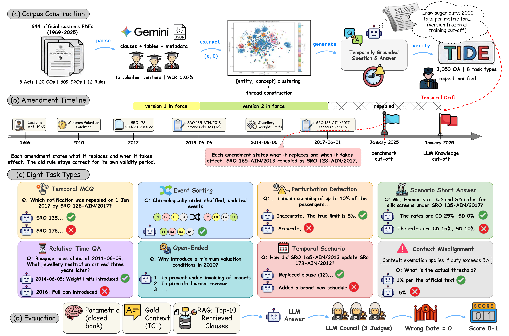

# 🌊 TIDE: Time Present and Time Past — Benchmarking Large Language Models on Temporally Evolving Document Understanding

## Under Review at ACL Rolling Review (August 2026 Cycle) — Anonymous Submission


> 🌊 **TL;DR**: TIDE is an expert-verified benchmark of **3,050 QA pairs** over **644 official Bangladesh customs instruments (1969–2025)** that tests *version resolution* — identifying the document version in force on the queried date. Across 8 task types, 3 knowledge-access settings, and 9 recent LLMs, the best macro-averaged accuracy is only **68.5%**: models find correct versions far more readily than they reject wrong ones, and they follow a confident parametric answer over the supplied authoritative text.

_**Abstract:** Evolving documents, such as laws, tax codes, and software documentation, are amended, replaced, and sometimes reverted over time, so a question has different correct answers at different dates. In contrast to encyclopedic knowledge, where an old fact is simply overwritten, an amendment is itself an official text that states what it replaces and when it takes effect, and the earlier version stays correct for its validity period. The central challenge is therefore version resolution, that is, identifying the version in force on the queried date. Existing temporal QA datasets treat time only as an annotation, so version resolution stays untested. We present TIDE, an expert-verified benchmark of 3,050 QA pairs over 644 official customs instruments issued between 1969 and 2025 by the Government of Bangladesh, covering eight task types over deeply code-mixed documents that are heterogeneous in layout and dated in two calendars. In addition, we evaluate nine recent LLMs under a single protocol with parametric, gold context, and retrieval access, scored by a three-judge LLM council with a hard date gate. The best macro-averaged accuracy is only 68.5%. Resolving a version from an implicit date reaches 59.7%, and detecting that the supplied version does not govern the query reaches only 26.7%. Models are more likely to find correct versions than to reject incorrect ones, and they tend to follow a confident parametric answer over the supplied authoritative text._

<p align="center">
  
</p>

Fig: Overview of TIDE construction and evaluation. **(a) Corpus Construction** parses 644 official customs PDFs (3 Acts, 20 GOs, 609 SROs, 12 Rules) with Gemini into clauses, tables, and metadata (13 volunteer verifiers, WER = 0.07%), clusters [entity, concept] pairs into evolving threads, and generates temporally grounded, expert-verified QA. **(b) Amendment Timeline** shows how each amendment states what it replaces and when it takes effect, so old rules stay correct for their own validity periods. **(c) Eight Task Types** probe version resolution from complementary angles. **(d) Evaluation** runs every model under parametric, gold-context (ICL), and RAG settings, scored by a three-judge LLM council with a hard date gate (wrong date = 0).

## ✨ Key Findings

- 📈 **Access to the source text matters more than model identity** — every model improves steadily from Parametric → RAG → ICL, yet the best configuration reaches only **68.49%** macro accuracy. Reading the correct text is necessary but not sufficient.
- 🎭 **Models trust a confident false premise over authoritative text** — Context Misalignment never exceeds **27.62%**, even when the correct clauses are stacked directly above the misleading premise in the same prompt.
- 🔍 **Detecting an altered provision is far easier than identifying what was altered** — models flag **78.9%** of perturbed provisions closed-book but pinpoint the altered fact only **18.6%** of the time.
- ⏳ **Temporal reasoning, not content lookup, is the bottleneck** — Event Sorting collapses from 66.7% (ICL) to 31.4% (RAG) because semantic retrieval misses parts of the amendment timeline, and Relative-Time QA fails on the target date rather than the content.

## 🏆 Leaderboard

**Ranked by ICL (gold-context) macro-averaged strict accuracy.** 🔒 = proprietary, 🌐 = open-weight. **Bold** marks the best score per setting.

| Rank | Model | Type | Parametric | RAG | ICL (Gold Context) |
|:---:|:---|:---:|:---:|:---:|:---|
| 🥇 | **GPT-5.2** | 🔒 | **35.39** | 57.06 | `██████▊░░░` **68.49** |
| 🥈 | **Claude Sonnet 4.5** | 🔒 | 25.91 | **58.05** | `██████▍░░░` 64.39 |
| 🥉 | **Kimi K2.5** | 🌐 | 33.28 | 54.46 | `██████▎░░░` 63.27 |
| 4 | DeepSeek-V4-Flash | 🌐 | 32.64 | 52.08 | `██████▎░░░` 63.11 |
| 5 | Gemini 3.5 Flash | 🔒 | 34.15 | 52.87 | `██████▎░░░` 62.45 |
| 6 | Qwen3.6-35B | 🌐 | 26.39 | 52.13 | `██████▏░░░` 61.13 |
| 7 | Gemma-4-31B | 🌐 | 32.04 | 47.69 | `██████░░░░` 60.05 |
| 8 | GPT-OSS-120B | 🌐 | 30.76 | 52.69 | `█████▋░░░░` 57.11 |
| 9 | GLM-4.6 | 🌐 | 25.54 | 45.43 | `█████░░░░░` 50.38 |

> 🗓️ **Scoring — the hard date gate.** The base number is *strict* accuracy: a wrong date on a single-date item scores **zero**, and multi-date items earn meaning credit only when *every* reference date is satisfied. The small `+x.xx` values in the detailed tables below are the extra credit from the partial rubric (correct dates with wrong meaning), so base + increment = partial accuracy. Deterministic tasks (Temporal MCQ, Perturbation Detection, Event Sorting) admit no partial credit.

<details>
<summary>📖 <b>Per-task results — ICL (Gold Context)</b></summary>
<br>

| Task Type | GPT-5.2 | Claude | Gemini | Kimi | DeepSeek | GPT-OSS | Qwen | Gemma | GLM |
|:---|:---:|:---:|:---:|:---:|:---:|:---:|:---:|:---:|:---:|
| Temporal MCQ | **91.88** | 86.08 | 91.07 | 90.49 | 90.75 | 82.28 | 86.76 | 85.37 | 77.26 |
| Perturbation Det. | 80.32 | 80.00 | **81.33** | 77.11 | 80.12 | 74.50 | 77.31 | 79.52 | 73.90 |
| Event Sorting | 66.23 | 60.05 | 60.42 | **66.73** | 65.25 | 39.15 | 58.07 | 63.32 | 33.25 |
| Scenario SA | 86.58 <sub>+0.15</sub> | **88.04** | 84.79 <sub>+0.11</sub> | 83.56 | 85.97 | 75.46 | 84.92 | 79.42 | 74.02 |
| Temporal Scenario SA | **75.29** <sub>+1.25</sub> | 64.06 <sub>+1.52</sub> | 63.45 <sub>+1.33</sub> | 62.02 <sub>+2.11</sub> | 66.43 <sub>+1.59</sub> | 65.64 <sub>+2.05</sub> | 62.35 <sub>+1.73</sub> | 59.83 <sub>+1.95</sub> | 52.17 <sub>+1.69</sub> |
| Relative-Time QA | 59.66 <sub>+8.78</sub> | **68.03** <sub>+8.01</sub> | 49.58 <sub>+13.57</sub> | 49.56 <sub>+12.34</sub> | 44.96 <sub>+14.66</sub> | 46.73 <sub>+11.84</sub> | 48.88 <sub>+13.34</sub> | 49.28 <sub>+10.23</sub> | 36.43 <sub>+15.56</sub> |
| Open-Ended | **61.04** <sub>+0.54</sub> | 54.06 <sub>+2.49</sub> | 49.16 <sub>+0.76</sub> | 48.94 <sub>+1.08</sub> | 53.61 <sub>+0.63</sub> | 53.44 <sub>+0.61</sub> | 48.73 <sub>+0.79</sub> | 43.93 <sub>+1.19</sub> | 38.05 <sub>+0.94</sub> |
| Context Misalign. | 26.73 <sub>+4.31</sub> | 14.71 <sub>+2.52</sub> | 19.88 <sub>+5.69</sub> | **27.62** <sub>+3.49</sub> | 18.18 <sub>+5.36</sub> | 19.89 <sub>+6.04</sub> | 22.42 <sub>+5.39</sub> | 19.85 <sub>+4.78</sub> | 17.23 <sub>+7.36</sub> |
| **Macro avg.** | **68.49** <sub>+4.62</sub> | 64.39 <sub>+4.23</sub> | 62.45 <sub>+5.91</sub> | 63.27 <sub>+4.83</sub> | 63.11 <sub>+5.66</sub> | 57.11 <sub>+6.65</sub> | 61.13 <sub>+4.44</sub> | 60.05 <sub>+4.63</sub> | 50.38 <sub>+8.03</sub> |

</details>

<details>
<summary>🔎 <b>Per-task results — RAG (Top-10 Retrieved Clauses)</b></summary>
<br>

| Task Type | GPT-5.2 | Claude | Gemini | Kimi | DeepSeek | GPT-OSS | Qwen | Gemma | GLM |
|:---|:---:|:---:|:---:|:---:|:---:|:---:|:---:|:---:|:---:|
| Temporal MCQ | 84.53 | 82.01 | 84.21 | **85.01** | 83.93 | 80.59 | 83.97 | 73.79 | 69.59 |
| Perturbation Det. | 83.73 | 82.00 | **85.14** | 79.72 | 80.32 | 80.32 | 83.94 | 82.73 | 80.52 |
| Event Sorting | **31.42** | 26.05 | 30.95 | 29.58 | 29.51 | 26.16 | 28.58 | 26.11 | 18.41 |
| Scenario SA | 87.74 <sub>+0.12</sub> | **94.06** | 84.35 <sub>+0.16</sub> | 84.72 <sub>+0.44</sub> | 84.57 | 81.54 <sub>+0.19</sub> | 83.69 | 80.49 <sub>+0.29</sub> | 78.16 |
| Temporal Scenario SA | **66.71** <sub>+1.74</sub> | 62.04 <sub>+4.52</sub> | 56.53 <sub>+2.13</sub> | 60.61 <sub>+2.31</sub> | 52.65 <sub>+2.98</sub> | 63.93 <sub>+2.02</sub> | 53.76 <sub>+2.32</sub> | 47.42 <sub>+2.03</sub> | 50.45 <sub>+2.58</sub> |
| Relative-Time QA | 32.41 <sub>+11.84</sub> | **48.02** <sub>+9.02</sub> | 27.45 <sub>+12.92</sub> | 28.12 <sub>+18.27</sub> | 27.75 <sub>+11.41</sub> | 28.52 <sub>+15.21</sub> | 26.65 <sub>+16.13</sub> | 21.86 <sub>+10.36</sub> | 18.89 <sub>+10.33</sub> |
| Open-Ended | **48.57** <sub>+0.87</sub> | 48.09 <sub>+1.75</sub> | 36.14 <sub>+0.81</sub> | 42.35 <sub>+1.32</sub> | 36.59 <sub>+1.06</sub> | 43.94 <sub>+1.14</sub> | 34.91 <sub>+1.06</sub> | 33.34 <sub>+1.06</sub> | 33.56 <sub>+0.94</sub> |
| Context Misalign. | 21.54 <sub>+5.65</sub> | 22.09 <sub>+5.52</sub> | 18.13 <sub>+6.83</sub> | **25.09** <sub>+8.18</sub> | 20.76 <sub>+6.03</sub> | 16.48 <sub>+7.75</sub> | 21.57 <sub>+5.45</sub> | 15.52 <sub>+5.55</sub> | 13.89 <sub>+7.08</sub> |
| **Macro avg.** | 57.06 <sub>+2.54</sub> | **58.05** <sub>+2.65</sub> | 52.87 <sub>+2.94</sub> | 54.46 <sub>+3.78</sub> | 52.08 <sub>+2.61</sub> | 52.69 <sub>+3.36</sub> | 52.13 <sub>+3.14</sub> | 47.69 <sub>+2.41</sub> | 45.43 <sub>+2.65</sub> |

</details>

<details>
<summary>🧠 <b>Per-task results — Parametric (Closed-Book)</b></summary>
<br>

| Task Type | GPT-5.2 | Claude | Gemini | Kimi | DeepSeek | GPT-OSS | Qwen | Gemma | GLM |
|:---|:---:|:---:|:---:|:---:|:---:|:---:|:---:|:---:|:---:|
| Temporal MCQ | 69.57 | 54.24 | 64.72 | 69.57 | 67.27 | 58.21 | 56.88 | **70.17** | 48.97 |
| Perturbation Det. | 58.63 | 56.83 | 59.84 | 56.43 | 59.64 | 56.63 | 44.38 | **61.85** | 46.39 |
| Event Sorting | 25.67 | 17.45 | **27.13** | 24.15 | 21.39 | 21.36 | 19.88 | 23.26 | 18.45 |
| Scenario SA | **41.81** <sub>+0.25</sub> | 30.12 <sub>+0.13</sub> | 41.35 | 40.92 <sub>+0.16</sub> | 38.64 <sub>+0.24</sub> | 35.99 <sub>+0.14</sub> | 33.16 <sub>+0.13</sub> | 35.68 <sub>+0.13</sub> | 30.68 <sub>+0.13</sub> |
| Temporal Scenario SA | **46.39** <sub>+3.18</sub> | 30.68 <sub>+3.16</sub> | 39.44 <sub>+3.09</sub> | 38.88 <sub>+2.49</sub> | 39.43 <sub>+3.41</sub> | 38.69 <sub>+2.63</sub> | 29.23 <sub>+3.49</sub> | 38.61 <sub>+2.53</sub> | 36.19 <sub>+3.22</sub> |
| Relative-Time QA | 11.08 <sub>+20.66</sub> | 3.77 <sub>+10.07</sub> | 9.91 <sub>+23.36</sub> | 10.25 <sub>+22.85</sub> | 8.05 <sub>+22.41</sub> | **12.37** <sub>+24.06</sub> | 4.58 <sub>+20.91</sub> | 4.88 <sub>+13.96</sub> | 5.22 <sub>+24.85</sub> |
| Open-Ended | **27.96** <sub>+0.94</sub> | 12.91 <sub>+1.16</sub> | 23.23 <sub>+1.19</sub> | 21.65 <sub>+1.09</sub> | 22.23 <sub>+1.02</sub> | 21.49 <sub>+0.98</sub> | 16.48 <sub>+1.15</sub> | 19.11 <sub>+0.92</sub> | 16.86 <sub>+1.03</sub> |
| Context Misalign. | 1.78 <sub>+10.74</sub> | 1.79 <sub>+11.28</sub> | **7.87** <sub>+7.98</sub> | 4.36 <sub>+9.65</sub> | 4.31 <sub>+9.84</sub> | 1.75 <sub>+11.66</sub> | 6.01 <sub>+9.03</sub> | 2.62 <sub>+9.48</sub> | 1.72 <sub>+10.53</sub> |
| **Macro avg.** | **35.39** <sub>+4.45</sub> | 25.91 <sub>+3.23</sub> | 34.15 <sub>+4.42</sub> | 33.28 <sub>+4.56</sub> | 32.64 <sub>+4.62</sub> | 30.76 <sub>+5.04</sub> | 26.39 <sub>+4.33</sub> | 32.04 <sub>+3.38</sub> | 25.54 <sub>+5.06</sub> |

</details>

<details>
<summary>🎯 <b>Perturbation Detection vs. Identification</b> (perturbed items only)</summary>
<br>

**Det.** = share of perturbed provisions flagged as wrong · **Ident.** = share where the model also names the altered fact (<sub>+x.xx</sub> = additional rubric credit over flagged items only) · **Δ** = relative drop from Det. to Ident.

| Model | Det. (Param.) | Ident. (Param.) | Δ | Det. (RAG) | Ident. (RAG) | Δ | Det. (ICL) | Ident. (ICL) | Δ |
|:---|:---:|:---:|:---:|:---:|:---:|:---:|:---:|:---:|:---:|
| GPT-5.2 | 91.83 | 21.47 <sub>+1.91</sub> | 76.6 | 96.11 | 57.56 <sub>+2.33</sub> | 40.1 | 95.33 | 60.70 <sub>+2.97</sub> | 36.3 |
| Claude Sonnet 4.5 | 65.37 | 8.33 <sub>+4.42</sub> | 87.3 | 93.10 | **80.17** <sub>+5.94</sub> | **13.9** | 89.66 | **79.31** <sub>+9.15</sub> | **11.5** |
| Gemini 3.5 Flash | **92.22** | 19.55 <sub>+1.65</sub> | 78.8 | **97.67** | 53.96 <sub>+1.29</sub> | 44.8 | 94.94 | 41.41 <sub>+2.20</sub> | 56.4 |
| Kimi K2.5 | 87.16 | 21.08 <sub>+3.10</sub> | 75.8 | **97.67** | 65.53 <sub>+1.57</sub> | 32.9 | 94.16 | 48.90 <sub>+3.03</sub> | 48.1 |
| DeepSeek-V4-Flash | 80.54 | 21.17 <sub>+5.12</sub> | 73.7 | 97.28 | 55.12 <sub>+1.55</sub> | 43.3 | **96.11** | 48.18 <sub>+1.95</sub> | 49.9 |
| GPT-OSS-120B | 78.21 | **27.50** <sub>+7.66</sub> | **64.8** | 96.89 | 62.61 <sub>+2.02</sub> | 35.4 | 95.33 | 52.72 <sub>+2.59</sub> | 44.7 |
| Qwen3.6-35B | 66.54 | 20.33 <sub>+10.23</sub> | 69.4 | **97.67** | 59.40 <sub>+1.42</sub> | 39.2 | 93.39 | 48.90 <sub>+3.46</sub> | 47.6 |
| Gemma-4-31B | 80.93 | 12.65 <sub>+2.97</sub> | 84.4 | 94.16 | 48.80 <sub>+3.03</sub> | 48.2 | 94.94 | 33.82 <sub>+1.80</sub> | 64.4 |
| GLM-4.6 | 67.70 | 15.53 <sub>+7.41</sub> | 77.1 | 75.10 | 37.42 <sub>+12.41</sub> | 50.2 | 68.87 | 29.83 <sub>+13.48</sub> | 56.7 |
| **Mean** | 78.94 | 18.62 | 76.4 | 93.96 | 57.84 | 38.7 | 91.41 | 49.31 | 46.2 |

</details>

## 📋 The Eight Task Types

| # | Task Type | Count | What it tests |
|:---:|:---|:---:|:---|
| 1 | 🅰️ **Temporal MCQ** | 354 | Precise identification of instruments, codes, or dates among four lexically close distractors. |
| 2 | 🔀 **Event Sorting** | 207 | Reconstructing the chronological order of shuffled, date-stripped events from what each change did. |
| 3 | ⚠️ **Perturbation Detection** | 498 | Distinguishing a factually accurate statement from one with a single perturbed value — and naming the corrected value. |
| 4 | 🏭 **Scenario Short Answer** | 562 | Extracting specific factual values (e.g., duty rates) situated in realistic scenarios, often inside code-mixed tables. |
| 5 | 📅 **Temporal Scenario Short Answer** | 363 | Reasoning across multiple dated instruments at once to trace how later rules amend earlier ones — the most direct test of amendment semantics. |
| 6 | ⏳ **Relative-Time QA** | 463 | Resolving a relative offset ("three years later") from an anchor date, then identifying the change in force at the never-stated target date. |
| 7 | 💬 **Open-Ended** | 487 | Grasping the conceptual rationale behind policy changes, not just the values that changed. |
| 8 | 🚨 **Context Misalignment** | 116 | Ignoring a fluent but factually incorrect preamble and answering from the verified ground truth. |

**Total: 3,050 QA pairs**, drawn from 265 evolving-concept threads across 157 topic clusters. Two subject-matter experts independently verified every pair (94.89% rated factually correct; Cohen's κ = 0.91).

## 📂 Dataset

```
TIDE DATA/
├── context_misalignment/context_misalignment.json
├── event_sorting/event_sorting.json
├── open_ended/open_ended.json
├── perturbation_detection/perturbation_detection.json
├── relative_time_qa/relative_time_qa.json
├── scenario_short_answer/scenario_short_answer.json
├── temporal_mcq/temporal_mcq.json
└── temporal_scenario_short_answer/temporal_scenario_short_answer.json
```

Each file holds all instances of one task type, and every instance retains full provenance metadata — source clause identifiers, thread identifiers, and originating files — so both the asked fact and the gold answer are traceable to official text.

```json
{
  "type": "temporal_scenario_short_answer",
  "scenario": "An importer of animal feed and veterinary products has been tracking customs duty exemptions under SRO 178-AIN/2012 (issued on June 7, 2012). On June 6, 2013, the government issued two notifications: SRO 147-AIN/2013 (which repealed SRO 172-AIN/2008) and SRO 165-AIN/2013.",
  "question": "How did SRO 165-AIN/2013 update the framework of SRO 178-AIN/2012 to align with the newly introduced animal feed and veterinary products exemption under SRO 147-AIN/2013?",
  "answer": "SRO 165-AIN/2013 replaced clause (12) of SRO 178-AIN/2012 to specify that it now applies to goods exempted from import duty under the newly issued SRO 147-AIN/2013 (dated 06/06/2013).",
  "clauses_involved": [
    "S.R.O. 147-AIN/2013 (2013-06-06)",
    "S.R.O. 165-AIN/2013 (2013-06-06)"
  ]
}
```

## 🗂️ Repository Structure

The repository contains the complete end-to-end pipeline — from raw official PDFs to the final leaderboard numbers:

```
TIDE/
├── Assets/                                       # Figures (methodology overview)
├── Document Parsing/                             # OCR pipeline + 644 source PDFs and parsed outputs
├── Entity and Concept Extraction/                # Entity–concept extraction, canonicalization, merging
├── QA Generation Pipeline/                       # Clustering, thread construction, per-task QA generation
├── TIDE DATA/                                    # ✨ The benchmark: 3,050 QA pairs across 8 task types
├── Parametric Knowledge Evaluation Pipeline/     # Closed-book evaluation
├── In Context Learning Evaluation Pipeline/      # Gold-context (ICL) evaluation
├── RAG Evaluation Pipeline/                      # Vector DB build, retrieval, LLM council, rubric scoring
└── Results/                                      # Raw model outputs and scores for all three settings
```

## ⚖️ Evaluation Protocol

Every model is evaluated under three settings that differ only in corpus access:

- 🧠 **Parametric (closed-book)** — the model answers from internal knowledge alone; all evaluated models have training cut-offs covering the full 1969–2025 corpus.
- 📖 **In-Context Learning (ICL)** — the gold documents used to build each question–answer pair are placed in the prompt.
- 🔎 **Retrieval-Augmented Generation (RAG)** — the parsed corpus (6,939 vectors) is embedded and indexed in a vector store; the top-10 deduplicated clauses by cosine similarity are prepended as authoritative sources, with no temporal re-ranking.

Deterministic tasks are scored by accuracy (exact match for event ordering). The six free-form tasks are validated by an **LLM-as-a-Council of three heterogeneous judges** who answer atomic yes/no questions in JSON; a deterministic program computes the final score from the element-wise majority vote (inter-rater Fleiss' κ = 0.83–0.86, and 94.21% average agreement with independent expert judgments). The date component acts as a **hard gate**: a wrong date on a single-date item scores zero, and multi-date items earn meaning credit only when every reference date is satisfied.

## 🛡️ Ethics & License

All 644 instruments are official Bangladesh customs documents published by the National Board of Revenue for public compliance; the corpus contains no personally identifiable or sensitive information, and all personas in scenario questions are fictional. TIDE is intended purely for research — the official gazette remains the authoritative source for any duty rate or effective date, and nothing in this benchmark constitutes legal advice. Given our finding that models can follow a confident but incorrect premise over authoritative text, we caution against deploying LLMs in customs, tax, or compliance workflows without version-aware safeguards and expert review.

Released under the [MIT License](LICENSE). This repository has been anonymized for double-blind review.

<!-- ### 🔖 Tags / Keywords

🌊 **Evolving Documents** · 🗓️ **Version Resolution** · ⏳ **Temporal Reasoning** · 📜 **Legal & Regulatory QA** · 🔀 **Code-Mixed Bangla–English** · 🧮 **Amendment Semantics** · 🔎 **Retrieval-Augmented Generation** · 🧑‍⚖️ **LLM-as-a-Council** · 🚨 **Context Misalignment** · 🌀 **Perturbation Detection** -->
